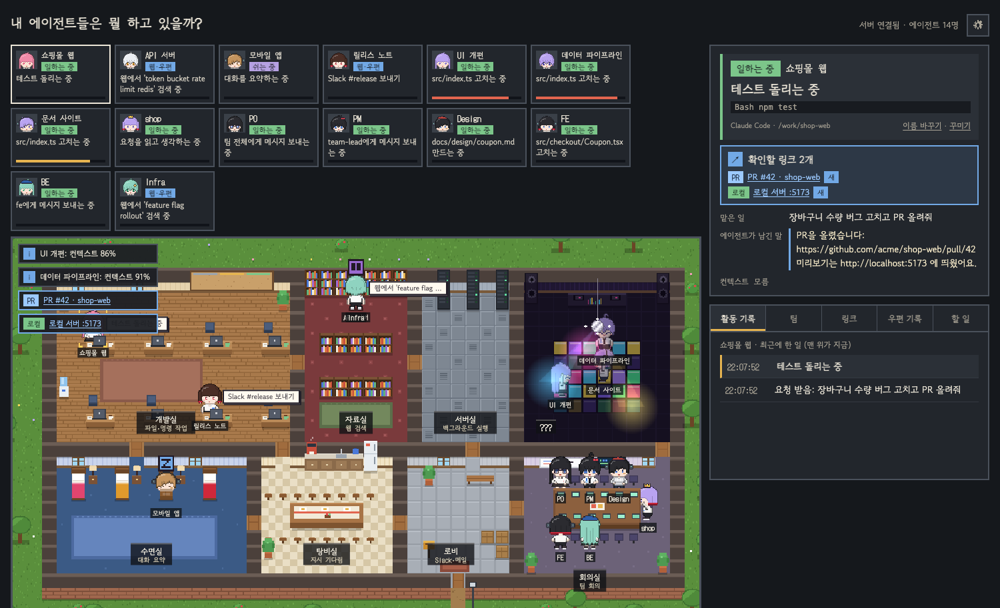
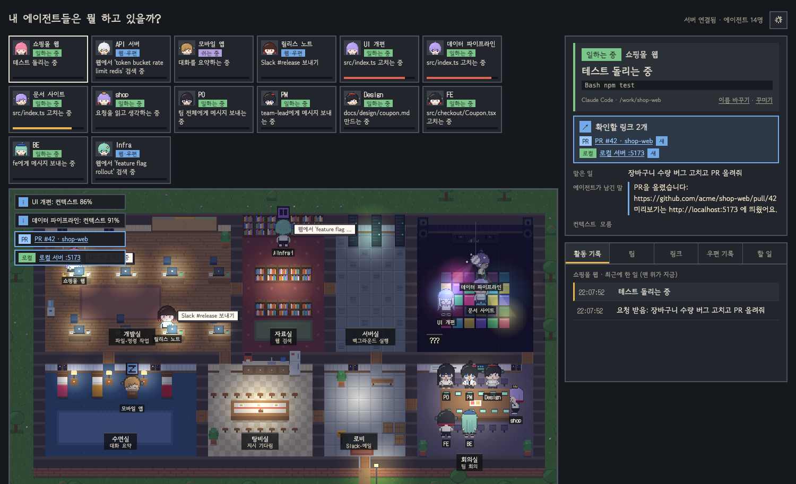
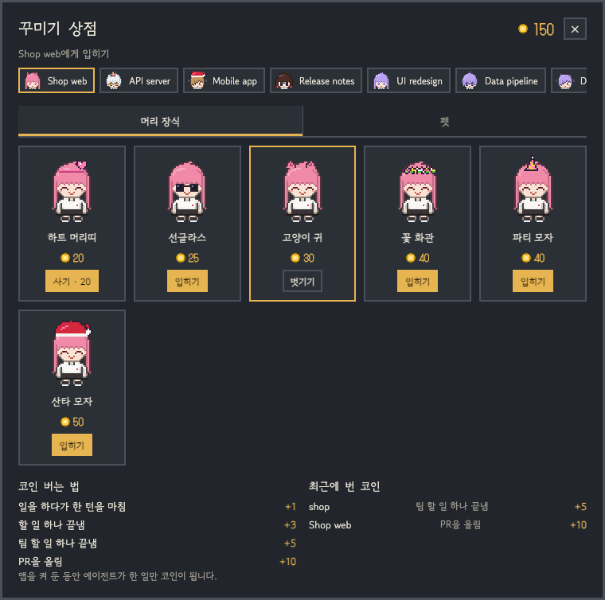
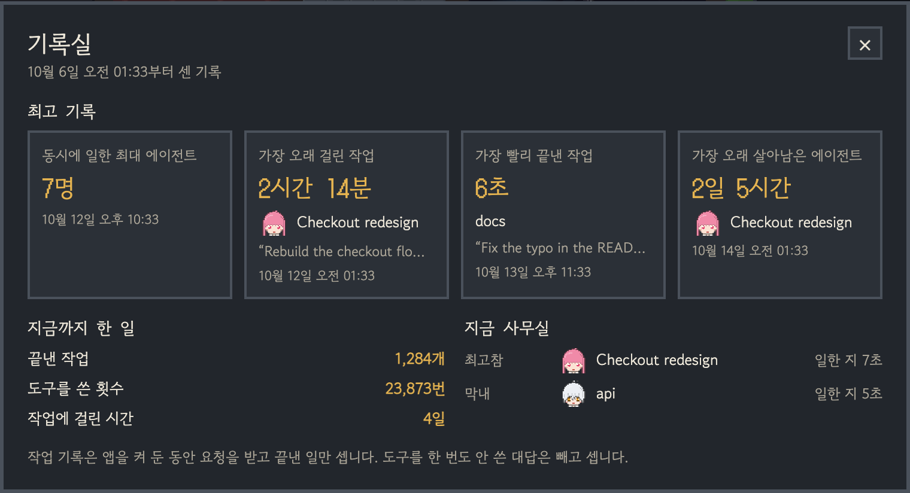
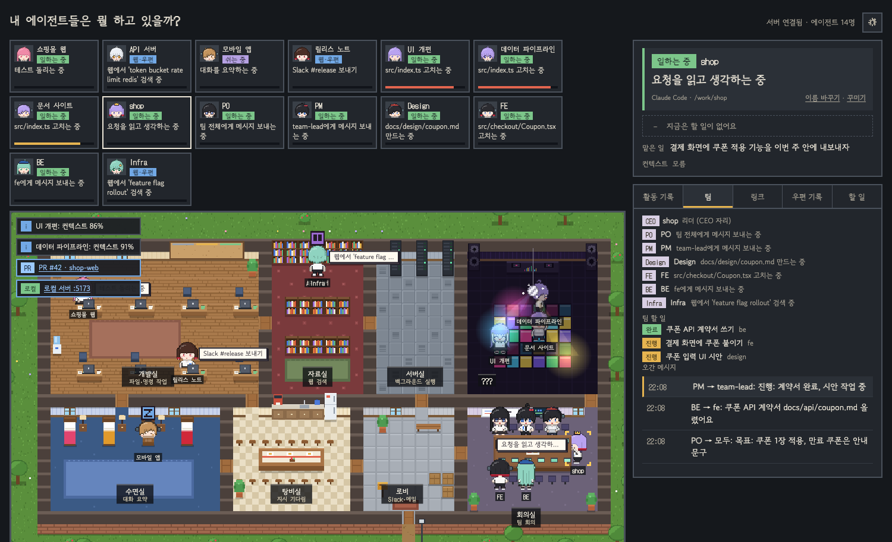

# What Are My Agents Doing? (내 에이전트들은 뭘 하고 있을까?)

<p align="center"></p>
<p align="center"><sub>컨텍스트가 80%를 넘은 에이전트는 몰래 숨은 <b>???</b> 방에 가서 춤춥니다.</sub></p>

**내 컴퓨터에서 돌아가는 Claude Code 에이전트들이 지금 뭘 하는지, 픽셀 회사 화면으로 한눈에 보여 주는 로컬 대시보드**

명령어 이름은 첫 글자를 딴 **`wamad`** 입니다.

[English](README.md)



터미널 창을 여러 개 띄워 에이전트를 돌리다 보면 어느 창이 무슨 일을 하는지, 어느 창이 내 승인을 기다리는지 놓치기 쉽습니다.
이 도구는 에이전트 하나를 캐릭터 하나로 바꿔 회사 지도 위에 세워 둡니다.

- 일하는 에이전트는 개발실 책상에서 타이핑합니다.
- 웹을 찾아보는 에이전트는 자료실로 갑니다.
- 컨텍스트가 차서 정리(compact)하는 에이전트는 수면실에서 잡니다.

그래서 지도만 봐도 누가 무엇을 하는지 바로 보입니다.

- **설치만 하면 바로 보입니다.** 지난 1시간 안에 움직인 Claude Code 세션은 이미 실행 중이어도 자동으로 나타납니다.
- **내 컴퓨터 안에서만 동작합니다.** 127.0.0.1에서만 열리고, 아무것도 밖으로 보내지 않습니다.
- **한국어 / English** 화면을 지원합니다.

버전마다 바뀐 점은 [CHANGELOG](CHANGELOG.md)에 있습니다.

---

## 어떤 대화가 보이나요

캐릭터 하나는 **이 컴퓨터에서 돌고 있는 Claude Code 대화 하나**입니다. 캐릭터를 늘리려면 대화를 여러 개 동시에 열면 됩니다.

| Claude와 대화하는 곳 | 보이나 | 이유 |
|---|---|---|
| 터미널의 Claude Code (Orca 같은 터미널 도구 포함) | ✅ | 이 컴퓨터에서 돈다 |
| VS Code의 Claude Code 확장 | ✅ 대화마다 한 명 | 이 컴퓨터에서 Claude Code를 돌린다 |
| Claude 데스크톱 앱 **Code** 탭 (이 컴퓨터에서 실행) | ✅ 세션마다 한 명 | 이 컴퓨터에서 Claude Code를 돌린다 |
| Claude 데스크톱 앱 **Chat** 탭, claude.ai | ❌ | Claude Code가 아니다. 대화가 Anthropic 서버에서만 돌고 이 컴퓨터에 읽을 기록이 남지 않는다 |
| 클라우드 세션 (Code 탭의 클라우드 세션, 웹의 claude.ai/code) | ❌ | 이 컴퓨터가 아니라 원격 컴퓨터에서 돈다 |
| Codex CLI, Gemini CLI | ❌ 아직 | 지원 예정 (앞으로 할 일 참고) |

- 1시간 동안 움직임이 없는 대화는 사무실에서 빠집니다.
- 에이전트 팀의 팀원은 한 명씩 캐릭터가 됩니다. 서브에이전트는 캐릭터 옆에 "+N 인턴"으로 작게 붙습니다.

---

## 데스크톱 앱 (터미널 필요 없음)

홈페이지에서 내려받으세요: **https://dioKR.github.io/what-are-my-agents-doing/**

- macOS(Apple Silicon / Intel)와 Windows용이 있습니다.
- 아직 서명하지 않은 앱이라 처음 열 때 경고가 뜹니다. 여는 방법은 홈페이지에 있습니다.
- 메뉴 막대에 머뭅니다: 화면 열기, Claude Code와 연결(버튼 하나로 훅 설치), 로그인할 때 자동 실행, 끄기.

## 빠른 시작 (터미널)

Node.js 20 이상이 있으면 한 줄이면 됩니다.

```bash
npx what-are-my-agents-doing
```

브라우저에서 **http://127.0.0.1:4545** 를 엽니다. `wamad` 명령을 계속 쓰려면 `npm install -g what-are-my-agents-doing`으로 한 번 설치하세요.

### 소스에서 실행

Node.js 23.6 이상이 필요합니다. TypeScript 파일을 빌드 없이 그대로 실행하기 때문입니다.

```bash
git clone https://github.com/dioKR/what-are-my-agents-doing.git
cd what-are-my-agents-doing
npm install
npm link      # wamad 명령을 어디서든 쓸 수 있게 등록 (한 번만)
wamad
```

브라우저에서 **http://127.0.0.1:4545** 를 엽니다. `npm link` 없이 `npm start`로 켜도 됩니다.

Claude Code에 아무 일이나 시키면 몇 초 안에 캐릭터가 나타납니다.

---

## 지도에서 보이는 것

| 에이전트가 하는 일 | 캐릭터가 있는 곳 |
|---|---|
| 파일 읽기·수정, 명령 실행 | **개발실** 책상에서 타이핑 |
| 웹 검색, 웹 문서 읽기 | **자료실** 책장 앞 |
| 백그라운드 명령 (`run_in_background`) | **서버실** (서버 불빛이 빨라짐) |
| 컨텍스트를 80% 넘게 씀 (곧 요약해야 함) | 회의실 위 숨은 방 **???** 에서 춤 (미러볼, 댄스 플로어) |
| 컨텍스트가 차서 정리(compact) | **수면실** 침대에서 잠 |
| 내 지시를 오래 기다림 (90초 넘게) | **탕비실**에서 커피 |
| 권한 승인 대기 | 자리에서 `!` 표시 + 지도 위 알림 |
| 같은 명령이 5번 연속 실패 | 개발실을 헤맴 + 빨간 알림 |
| Slack·메일 도구로 보내기/읽기 | **로비 우편함**까지 걸어가고, 배달부가 가져감 |
| 하위 에이전트(Task)에게 일을 맡김 | 책상 옆에 새싹 머리 인턴 |
| 할 일 목록(TodoWrite) | 개발실 벽 작업 보드에 카드 |
| 세션 종료 | 문으로 퇴근 |

### 오른쪽 패널

- **상세 칸**에는 고른 에이전트의 정보가 나옵니다.
  - 맡은 일(내가 보낸 요청)
  - 지금 하는 일(예: "테스트 돌리는 중")과 실제 명령
  - 에이전트가 마지막으로 남긴 말
  - 컨텍스트 사용량
- **링크**: 에이전트가 PR 주소나 로컬 서버 주소(`localhost:5173` 등)를 말하면, 지도 위 알림과 "링크" 탭에 눌러서 여는 링크로 모입니다.
- **탭**은 다섯 개입니다. 활동 기록 · 팀 · 링크 · 우편 기록 · 할 일

### 설정 (오른쪽 위 톱니바퀴)

- **시간대**는 지금 시각 / 낮 / 저녁 / 밤 중에서 고릅니다. "지금 시각"은 실제 시각에 맞춰 바뀌고, 밤에는 방 조명과 노트북 화면, 가로등이 켜집니다.
- **언어**는 한국어 / English 중에서 고릅니다. 처음에는 브라우저 언어를 따르고, 고른 값은 기억합니다.
- **앱에서 허용 · 거부** (처음에는 꺼져 있음). 아래를 보세요.

### 오른쪽 클릭 메뉴

지도 위 캐릭터나 위쪽 카드를 오른쪽 클릭하면:

- **허용 / 거부** (앱에서 승인을 기다리는 에이전트에만)
- **이름 바꾸기**, **꾸미기**
- **작업 폴더 열기** (Finder · 탐색기)
- **최근 링크 열기** (가장 최근에 알려 준 PR이나 로컬 서버)
- **사무실에서 내보내기**: 화면에서만 뺍니다. Claude Code는 그대로 돌고, 다시 일하면 돌아옵니다.

키보드로도 됩니다: 카드에 초점을 두고 메뉴 키(또는 Shift+F10)를 누른 뒤 ↑ ↓ 와 Enter.

### 권한 질문을 앱에서 허용 · 거부하기

설정에서 "권한 질문을 앱에서 받기"를 켭니다. Claude Code가 도구를 써도 되는지 물으면, 그 에이전트의 상세 칸에 무엇을 하려는지와 **허용** · **거부** 단추가 나옵니다.

- Claude Code는 앱의 대답을 **최대 30초** 기다립니다. 대답이 없으면 평소처럼 터미널에서 묻습니다. 그래서 앱을 꺼 두거나 못 보고 있어도 멈추지 않습니다.
- Claude Code의 `PermissionRequest` 훅을 씁니다. 훅이 앱의 대답을 기다렸다가 Claude Code에 넘깁니다. 허용을 눌러도 Claude Code에 정해 둔 거부 규칙은 그대로 적용됩니다.
- 데스크톱 앱은 이 훅을 알아서 더합니다. `wamad` 명령으로 쓰면 `wamad hooks install`을 한 번 다시 실행하세요.
- 이 컴퓨터에서 이 서버가 띄운 화면만 대답할 수 있습니다. 다른 웹사이트에서 온 요청은 거절합니다.



---

## 캐릭터


기본 캐릭터는 네 명입니다. 에이전트가 나타난 순서대로 차례로 배정됩니다.

| 순서 | 이름 | 생김새 |
|---|---|---|
| 1 | 분홍 머리 사원 | 긴 분홍 머리, 하트 눈, 블라우스와 사원증 |
| 2 | 하얀 머리 사원 | 곱슬 흰 머리, 호박색 눈, 셔츠와 넥타이, 목걸이 사원증 |
| 3 | 갈색 머리 사원 | 눈을 덮는 갈색 앞머리, 헤드폰, 볼 반창고, 회색 후드티 |
| 4 | 검은 머리 사원 | 끝을 붉게 물들인 단발, 빨간 눈, 명찰 단 흰 티셔츠, 은 귀걸이 |

다섯 번째 에이전트부터는 같은 네 명을 머리색과 눈색만 바꿔 씁니다.

- **꾸미기**: 상세 칸의 "꾸미기"를 누르면 머리색, 눈, 피부, 옷 색, 소품을 고를 수 있습니다. 고르는 즉시 지도 위 캐릭터에 입혀 보고, 저장하면 기억합니다.
  - 머리 모양이나 옷 모양까지 바꾸면 손으로 찍은 그림 대신 부품을 조립한 그림으로 바뀝니다.
- **이름 바꾸기**: 기본 이름은 세션 제목입니다. 제목이 없으면 작업 폴더 이름을 씁니다.
- 꾸민 모습과 이름은 "도구 + 작업 폴더" 기준으로 기억하므로, 같은 폴더에서 Claude Code를 다시 켜도 그대로 나옵니다.
- 기본 캐릭터 네 명은 32×44 크기 도트를 한 칸씩 찍어 그렸습니다 ([`web/src/office/character/sprites/`](web/src/office/character/sprites)).
  - 그림은 글자 지도로 저장합니다. 글자 하나가 픽셀 하나이고, 글자마다 색이 정해져 있어 머리색·옷 색을 바꿔 칠할 수 있습니다.
  - 머리는 캐릭터마다, 몸통은 옷마다, 팔·다리는 모두가 함께 쓰는 그림을 겹쳐 한 장을 만듭니다.
  - 방향: 4방향 (오른쪽은 왼쪽 그림을 뒤집어 씀)
  - 걷기: 4박자
  - 자세: 앉기, 타이핑, 생각, 손들기, 커피, 기지개, 상자 들기
  - 표정: 6가지

### 내 캐릭터 넣기 (PNG 시트)

직접 그린 캐릭터를 사무실에 넣을 수 있습니다.

1. "꾸미기"를 누르고 **템플릿 내려받기**를 누릅니다. 지금 캐릭터의 모든 방향 · 자세가 담긴 PNG 한 장이 내려받아집니다.
2. [Aseprite](https://www.aseprite.org/)나 [Piskel](https://www.piskelapp.com/)(무료, 웹) 같은 도트 툴로 그 위에 덧칠합니다. 격자를 32×44로 맞추면 칸이 보입니다.
3. **PNG 올리기**를 누르면 그 캐릭터가 바로 사무실을 돌아다닙니다. **저장**을 누르면 그 에이전트의 모습으로 기억합니다.

<p align="center"></p>

| | |
|---|---|
| 시트 크기 | 352×176 PNG, 배경은 투명 |
| 칸 하나 | 32×44 (한 장면) |
| 가로 칸 (자세) | stand(서기), walk1 · walk2(걷기), sit(앉기), type1 · type2(타이핑), think(생각), raise(손들기), drink(커피), stretch(기지개), carry(상자 들기) |
| 세로 줄 (방향) | down(앞), up(뒤), left(왼쪽), right(오른쪽) |
| 꼭 그릴 칸 | 앞 · 뒤 · 왼쪽의 서기와 걷기 두 장 (9칸) |
| 비워 둔 칸 | 같은 방향의 서기 그림을 씁니다. 오른쪽 줄을 비우면 왼쪽 줄을 뒤집어 씁니다 |

- 올린 시트는 `~/.wamad/characters/`에 저장되어 데스크톱 앱과 명령줄에서 똑같이 쓰입니다. 이름 옆 ✕로 지울 수 있습니다.
- 올린 캐릭터는 그린 그림 그대로 나오므로, 상점의 머리 장식은 그려지지 않습니다 (펫은 따라다닙니다).
- 애니메이션 · 게임 같은 다른 작품의 캐릭터는 내 컴퓨터에서 재미로만 쓰고, 그 시트를 공유하거나 올리지 말아 주세요. 이 프로젝트는 직접 만든 캐릭터만 담습니다.

---

## 꾸미기 상점

에이전트가 일하면 코인이 쌓이고, 그 코인으로 캐릭터에게 머리 장식과 펫을 사 줄 수 있습니다. 실제 돈은 쓰지 않습니다.

<p align="center"></p>
<p align="center"></p>

| 에이전트가 한 일 | 코인 |
|---|---|
| 일을 하다가 한 턴을 마침 | +1 |
| 할 일 하나 끝냄 | +3 |
| 에이전트 팀 할 일 하나 끝냄 | +5 |
| PR을 올림 | +10 |

- 오른쪽 위 코인 숫자를 누르면 상점이 열립니다. 상점 위쪽에서 캐릭터를 고르고 물건을 사서 입힙니다.
- 머리 장식: 하트 머리띠, 선글라스, 고양이 귀, 꽃 화관, 파티 모자, 산타 모자. 펫: 병아리, 슬라임, 고양이, 강아지. 펫은 캐릭터를 졸졸 따라다닙니다.
- 앱(또는 서버)을 켜 둔 동안 한 일만 코인이 됩니다. 켤 때 읽는 지난 기록은 세지 않습니다. 코인을 벌면 캐릭터 머리 위에 "+코인"이 떠오릅니다.
- 지갑은 `~/.wamad/wallet.json`에 저장되어, 다시 켜도 남고 데스크톱 앱과 명령줄에서 똑같이 쓰입니다.

## 기록실 (트로피 아이콘)

톱니바퀴 옆 트로피를 누르면 에이전트들이 세운 기록을 볼 수 있습니다.

<p align="center"></p>

- **최고 기록:** 동시에 일한 최대 에이전트 수, 가장 오래 걸린 작업, 가장 빨리 끝낸 작업, 가장 오래 살아남은 에이전트. 기록마다 세운 에이전트, 그때 받은 요청, 시각이 나옵니다.
- **지금까지 한 일:** 끝낸 작업 수, 도구를 쓴 횟수, 작업에 걸린 시간 합계.
- **지금 사무실:** 가장 먼저 시작한 최고참과 가장 늦게 시작한 막내.

세는 기준:

- **작업 하나**는 요청을 받은 순간부터 에이전트가 답을 끝낼 때까지입니다. 도구를 한 번도 안 쓴 대답은 빼서, "가장 빨리 끝낸 작업"이 한 줄짜리 대답으로 채워지지 않게 했습니다.
- **동시에 일한 수**는 내 지시를 기다리거나 끝난 에이전트를 뺀 수입니다.
- **살아남은 시간**은 에이전트가 시작한 때부터 마지막으로 움직인 때까지입니다.
- 코인처럼 앱(또는 서버)을 켜 둔 동안 일어난 일만 셉니다. 그래서 다시 켜도 같은 작업을 두 번 세지 않습니다. 기록은 `~/.wamad/records.json`에 저장됩니다.

## 팀과 회의실



Claude Code의 실험 기능인 **agent teams**를 쓰면 팀이 회의실에 모입니다.
- 내가 대화하는 리더는 **왕관을 쓰고 CEO 자리**에 앉습니다.
- 역할별 팀원(PO · PM · Design · FE · BE · Infra)은 테이블에 앉습니다.

| 일어나는 일 | 화면 |
|---|---|
| 내가 리더에게 지시 | 리더 머리 위에 `CEO: …` 말풍선, 팀원들이 리더 쪽을 돌아봄 |
| 팀원끼리 메시지 | 보낸 사람에게서 받는 사람에게 편지가 날아감, `→ FE: …` 말풍선 |
| 팀 할 일 생성·완료 | "팀" 탭 목록과 회의실 모니터 진행률 |
| 팀원이 웹 검색 | 자료실에 다녀옴 |
| 팀원이 리더나 다른 팀원에게서 일을 받음 | 회의실을 나가 개발실 책상 등 일하는 곳으로 흩어짐. 일을 마치고 기다릴 때는 회의실로 돌아옴 |

역할마다 소품이 다릅니다.

| 역할 | 소품 |
|---|---|
| PO | 안경 |
| PM | 리본 |
| Design | 베레모 |
| FE | 헤드폰 |
| BE | 모자 |
| Infra | 별 핀 |

### 팀 시작하기

1. 역할 정의 파일 6개를 내 프로젝트의 `.claude/agents/`에 복사합니다. 이미 같은 이름의 파일이 있으면 건너뛰고, 덮어쓰려면 `--force`를 붙입니다.

   ```bash
   wamad team install /path/to/my-project
   ```

2. 훅을 설치합니다. 팀원의 움직임은 훅으로만 보이기 때문입니다. 아래 "훅 설치"를 참고하세요.

3. 그 프로젝트에서 agent teams를 켜고 Claude Code를 시작합니다.

   ```bash
   CLAUDE_CODE_EXPERIMENTAL_AGENT_TEAMS=1 claude
   ```

4. 리더에게 이렇게 말합니다.

   > 에이전트 팀을 꾸려줘. po, pm, design, fe, be, infra 에이전트 타입으로 팀원을 하나씩 만들고, 회의실에서 내 지시를 기다리게 해. 내가 북극성 지표를 주면 역할별로 나누지 말고 팀 전체에 그대로 전달해. 일은 팀원들이 서로 메시지로 나눠 맡고, 끝나면 나에게 보고해.

5. 할 일은 북극성 지표 하나로 줍니다. 예: "첫 주 리텐션을 30%에서 40%로 올려줘". 역할별 지시는 하지 않습니다. PO가 목표와 가설을 세우고, 팀원들이 각자 맡을 일을 골라 서로 메시지로 넘겨받습니다.

역할 정의는 [`team/agents/`](team/agents)에 있습니다. 예를 들어 BE는 API 계약서를 먼저 써서 FE에게 알리고, FE는 로컬 서버 주소와 PR 주소를 리더에게 보고하도록 적혀 있습니다. 필요하면 프로젝트에 복사된 파일을 고쳐 쓰면 됩니다.

> agent teams는 실험 기능이라 이벤트와 메시지 형식이 공식 문서에 일부만 나와 있습니다. 지금은 문서에 나온 훅 필드를 기준으로 만들었습니다. 실제 팀에서 다르게 보이면 이슈로 알려 주세요.

---

## 훅 설치 (선택)

훅이 없어도 대부분의 상태는 Claude Code의 대화 기록(`~/.claude/projects/`)을 읽어서 보여 줍니다. 훅을 설치하면 아래 세 가지가 더 보입니다.

- 권한 승인 대기
- 하위 에이전트 시작·종료
- 팀원 이벤트

```bash
wamad hooks install --dry-run   # 바뀔 내용만 미리 보기
wamad hooks install             # ~/.claude/settings.json 에 훅 추가
wamad hooks uninstall           # 훅 빼기
```

훅을 설치해도 안전하도록 만들었습니다.

- 이미 있던 훅은 건드리지 않습니다.
- 바꾸기 전에 `settings.json.wamad-backup`으로 백업합니다.
- 훅 스크립트([`hooks/claude-hook.mjs`](hooks/claude-hook.mjs))는 받은 내용을 로컬 서버로 넘기기만 하고 아무것도 출력하지 않습니다.
desktop/main.mjs          데스크톱 앱(Electron): 메뉴 막대 아이콘, 창, Claude Code 연결
docs/index.html           홈페이지 (GitHub Pages)
- 서버가 꺼져 있어도 0.5초 안에 조용히 끝나므로 Claude Code를 막지 않습니다.
- 설치 후 새로 시작한 Claude Code 세션부터 훅이 적용됩니다.

---

## 개인정보와 보안

- 서버는 **127.0.0.1에서만** 열립니다. 같은 네트워크의 다른 컴퓨터에서는 접속할 수 없습니다.
- 앱에서 허용 · 거부는 처음에 꺼져 있습니다. 켜면 이 컴퓨터에서 이 서버가 띄운 화면만 대답할 수 있습니다 (서버가 Host · Origin 머리글을 확인하고 JSON만 받습니다).
- 대화 기록은 **읽기만** 합니다. 고치거나 지우지 않습니다.
- 외부로 보내는 요청이 없습니다. 화면 글꼴(Google Fonts)만 인터넷에서 받습니다.
- 데스크톱 앱은 새 버전이 나왔는지 알려 주려고 하루에 한 번 GitHub에 최신 릴리스 번호만 물어봅니다. 내 정보는 보내지 않고, 메뉴 막대 아이콘의 "새 버전 자동으로 확인"으로 끌 수 있습니다.
- Slack이나 메일로 결과물을 전달하는 일은 에이전트가 자기 도구로 직접 합니다. 이 도구는 그 장면을 보여 주기만 합니다.

---

## 문제 해결

**에이전트가 안 보여요**
- 지난 1시간 안에 움직인 세션만 보입니다. Claude Code에 일을 하나 시켜 보세요.
- 서버가 켜져 있는지 확인하세요. 오른쪽 위에 "서버 연결됨"이 보여야 합니다.

**글자가 `[object Object]`로 보여요**
- 서버를 새 버전으로 다시 켰는데 브라우저 탭은 예전 화면일 때 생깁니다. 탭을 새로고침하세요.
- 이번 버전부터는 서버와 화면의 버전이 다르면 화면이 스스로 새로고침합니다.

**4545 포트를 이미 쓰고 있어요**
- `WAMAD_PORT` 환경 변수로 바꿀 수 있습니다. 훅도 같은 변수를 읽습니다.

```bash
WAMAD_PORT=4600 wamad
```

**권한 승인 대기가 안 보여요**
- 승인 대기는 훅으로만 알 수 있습니다. `wamad hooks install`로 훅을 설치하세요.

---

## 개발

```bash
npm run server      # 로컬 서버 (4545)
npm run dev         # 화면 개발 서버 (Vite). /api 요청은 4545로 넘긴다
npm run typecheck
npm test            # 서버 동작, 코인 규칙, 도트 데이터 검사
npm run build && npm run test:e2e   # 설치된 Chrome으로 화면을 열어 오류가 없는지 검사
npm run desktop       # 데스크톱 앱(Electron)을 소스에서 실행
npm run dist:desktop  # 설치 파일을 release/ 에 만들기
```

PR이 올라오면 GitHub Actions가 같은 검사(타입 검사, 단위 테스트, 빌드, 브라우저 화면 검사)를 자동으로 돌립니다. 모두 초록불이면 머지해도 됩니다. 자세한 건 [CONTRIBUTING](CONTRIBUTING.md)에 있습니다.

`v`로 시작하는 태그를 올리면 GitHub Actions가 macOS·Windows 설치 파일을 만들어 GitHub Release에 붙입니다. 홈페이지는 `docs/`에 있습니다(GitHub Pages).

- 모든 캐릭터 조합 보기: `npm run dev`를 켠 뒤 http://localhost:5173/dev/dolls.html
- 기본 캐릭터 네 명 보기: http://localhost:5173/dev/cast.html

### 구조

```
shared/protocol.ts        서버와 화면이 함께 쓰는 상태 모양 (AgentSnapshot)
server/
  app.ts                  127.0.0.1 전용 HTTP 서버 + 실시간 전송(SSE). startServer()로 켠다
  index.ts                명령줄에서 서버 켜기
  claudeHook.ts           훅 이벤트 → 에이전트 상태 (순수 함수)
  claudeTranscript.ts     대화 기록 한 줄 → 훅과 같은 모양의 이벤트
  transcriptWatcher.ts    ~/.claude/projects 대화 기록을 2초마다 이어 읽기
  humanize.ts             도구 호출 → "테스트 돌리는 중" 같은 한국어·영어 문장
  links.ts                PR 주소·로컬 서버 주소 찾기
  team.ts                 팀 이벤트를 리더·팀원 상태로 나누기
  wallet.ts               일해서 번 코인, 상점 물건 사기·입히기 (~/.wamad/wallet.json)
  approvals.ts            앱에서 허용 · 거부: 대답을 기다리고, 이 화면에서 온 요청인지 확인
  characters.ts           올린 캐릭터 시트 (~/.wamad/characters/)
  records.ts              기록실: 작업 기록, 동시에 일한 최대 수, 가장 오래 살아남은 에이전트 (~/.wamad/records.json)
shared/shop.ts            상점 물건, 값, 코인 규칙 (서버와 화면이 함께 씀)
shared/records.ts         기록의 모양 (서버와 화면이 함께 씀)
e2e/                      브라우저(Chrome) 화면 검사
hooks/claude-hook.mjs     Claude Code가 실행하는 훅. 서버로 넘기기만 한다
team/agents/              역할별 팀원 정의 (po, pm, design, fe, be, infra)
web/src/
  office/                 지도, 가구, 조명, 캐릭터 이동(actors), 그리기(renderer), 지도 위 글자(labels)
  office/character/       캐릭터 그리기(doll). sprites/에 손으로 찍은 도트(머리·몸통·팔·다리·소품)
  panels/                 카드, 알림, 상세 칸, 탭, 꾸미기, 설정
  office/pets/             캐릭터를 따라다니는 펫 (도트 + 따라가기)
  shop/                   꾸미기 상점 창과 지갑 상태
  records/                기록실 창 (트로피 아이콘)
  characters/             올린 캐릭터 시트: 목록, 올리기, 템플릿 내려받기
  i18n.ts                 화면 언어(한국어·영어)
```

---

## 앞으로 할 일

- agent teams를 실제로 돌려 팀원 이벤트·메시지 형식 맞추기
- Codex CLI, Gemini CLI 지원 (상태 모양은 도구와 무관하게 만들어 두었고, 각 도구의 세션 기록을 읽는 부분이 필요)
- 테마 교체 (다른 회사 지도, 다른 캐릭터 세트)
- 사용량 한도 표시
