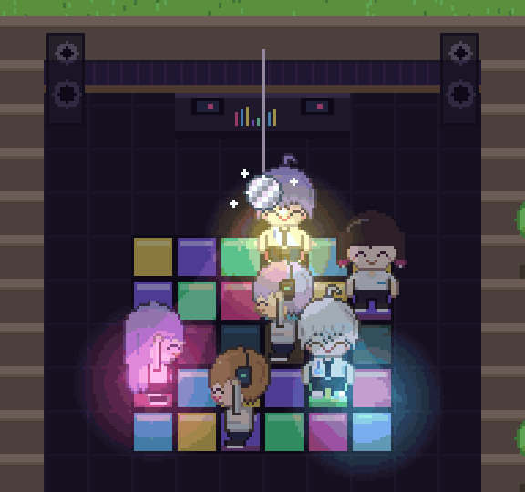
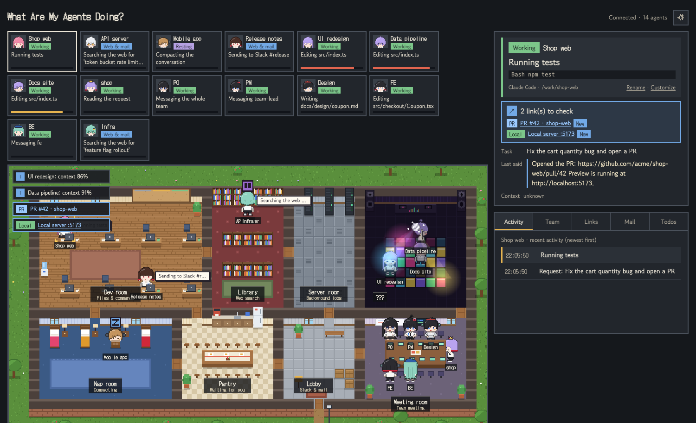
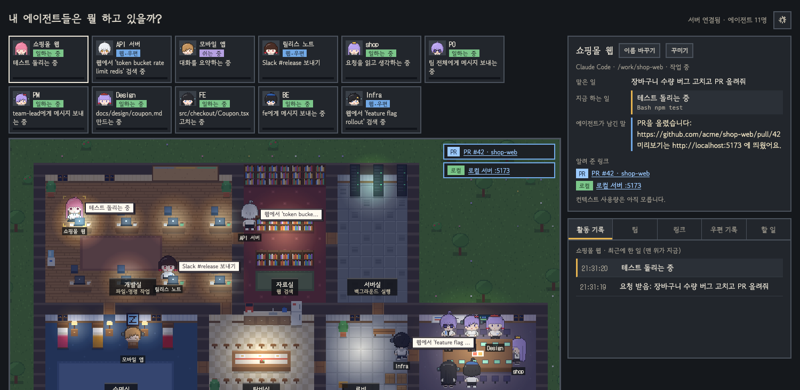
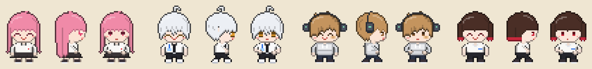
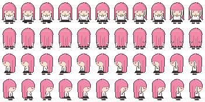
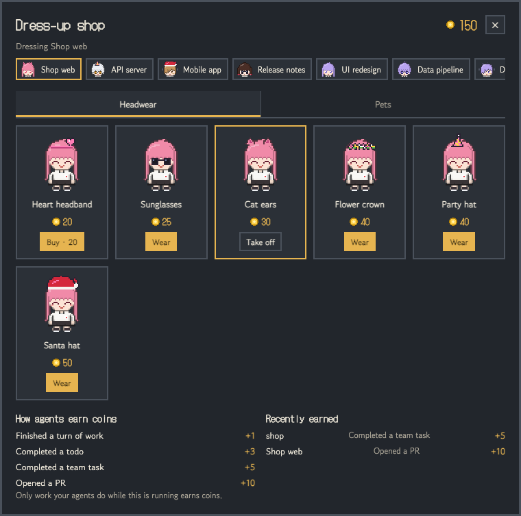
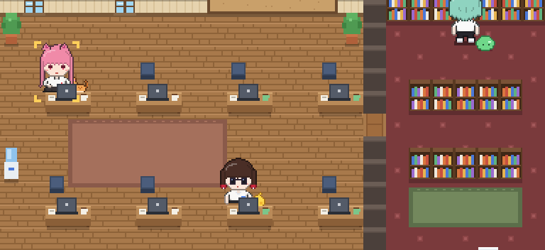
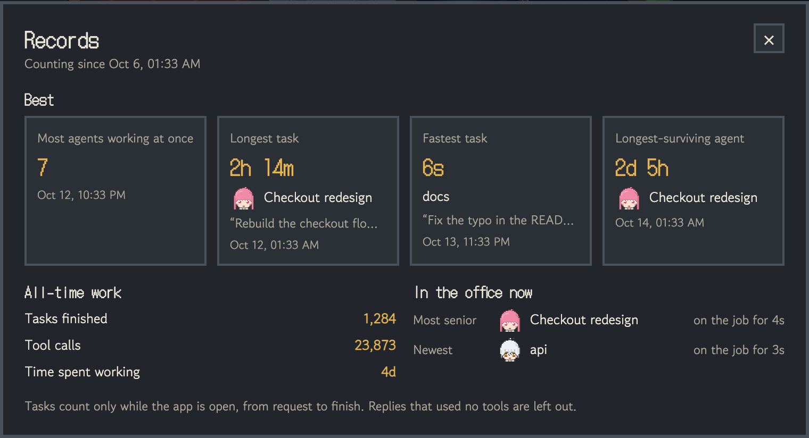
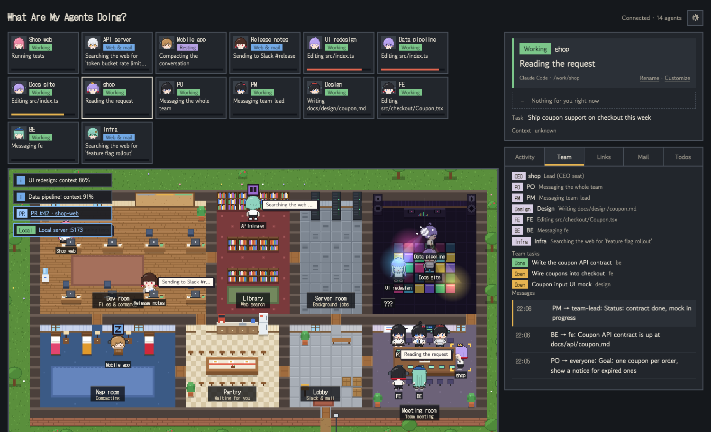

# What Are My Agents Doing?

<p align="center"></p>
<p align="center"><sub>When an agent's context passes 80%, it sneaks off to the hidden <b>???</b> room to dance.</sub></p>

**A local dashboard that shows what the Claude Code agents on your machine are doing right now, as a pixel-art office you can take in at a glance.**

The command is **`wamad`**, from the initials.

[한국어](README.ko.md)



When you run several agents in several terminal windows, it is easy to lose track of which one is doing what, and which one is waiting for your approval.
It turns each agent into a character and places it on an office map.

- Agents that are working type at a desk in the dev room.
- Agents searching the web walk to the library.
- Agents compacting their conversation take a nap in the nap room.

You can tell who is doing what at a glance.

- **Works right after install.** Claude Code sessions that were active in the last hour show up automatically, including ones that were already running.
- **Stays on your machine.** It listens on 127.0.0.1 only and sends nothing out.
- **Korean / English** UI.

What's new in each version: [CHANGELOG](CHANGELOG.md).

---

## Desktop app (no terminal needed)

Download it from the homepage: **https://dioKR.github.io/what-are-my-agents-doing/**

- macOS (Apple Silicon / Intel) and Windows.
- The app isn't signed yet, so your computer warns you the first time you open it. The homepage shows how to open it.
- It lives in the menu bar: open the office, connect to Claude Code (installs the hooks with one click), open at login, quit.

## Quick start (terminal)

With Node.js 20 or later, one line is enough:

```bash
npx what-are-my-agents-doing
```

Open **http://127.0.0.1:4545** in your browser. To keep the `wamad` command around, install it once with `npm install -g what-are-my-agents-doing`.

### From source

Requires Node.js 23.6 or later, because it runs the TypeScript files directly without a build step.

```bash
git clone https://github.com/dioKR/what-are-my-agents-doing.git
cd what-are-my-agents-doing
npm install
npm link      # register the wamad command (once)
wamad
```

Open **http://127.0.0.1:4545** in your browser. `npm start` works too, without `npm link`.

Give Claude Code any task. Its character appears within a few seconds.

---

## What you see on the map

| What the agent is doing | Where the character goes |
|---|---|
| Reading or editing files, running commands | Types at a desk in the **dev room** |
| Web search, reading web pages | In front of the **library** shelves |
| Background commands (`run_in_background`) | **Server room** (the server lights blink faster) |
| Context more than 80% used (compaction coming) | Dances in the hidden **???** room above the meeting room (disco ball, dance floor) |
| Compacting a full context | Sleeps in the **nap room** |
| Waiting for you for a while (over 90 seconds) | Has a coffee in the **lounge** |
| Waiting for permission | `!` at the desk + an alert on the map |
| The same command failed 5 times in a row | Wanders around the dev room + a red alert |
| Sending or reading Slack/email through a tool | Walks to the **lobby mailbox**; a courier picks it up |
| Delegating to a subagent (Task) | A sprout-haired intern next to the desk |
| A todo list (TodoWrite) | Cards on the dev room board |
| Session ended | Leaves through the front door |

### Side panel

- The **details** panel shows the selected agent's:
  - task (your request)
  - current step (e.g. "Running tests") with the actual command
  - last thing it said
  - context usage
- **Links**: when an agent mentions a PR URL or a local server (`localhost:5173`, etc.), it shows up as a clickable link in the alerts and in the "Links" tab.
- There are five **tabs**: Activity · Team · Links · Mail · Todos.

### Settings (gear icon, top right)

- **Time of day** can be Now / Day / Evening / Night. "Now" follows your clock; at night the room lights, laptop screens and the street lamp turn on.
- **Language** can be Korean or English. It starts from your browser language and remembers your choice.
- **Allow / deny in the app** (off by default). See below.

### Allow or deny permission prompts from the app

Turn on "Answer permission prompts here" in the settings. When Claude Code asks for permission to run a tool, the agent's details panel shows what it wants to run with **Allow** and **Deny** buttons.

- Claude Code waits up to **30 seconds** for your answer here. If you don't answer, it asks in the terminal as usual, so nothing gets stuck when the app is closed or you're not looking.
- This uses Claude Code's `PermissionRequest` hook: the hook waits for the app's answer and hands it to Claude Code. Your deny rules in Claude Code still apply even if you press Allow.
- The desktop app adds this hook automatically. If you use the `wamad` command, run `wamad hooks install` once again.
- Only this computer's own page can answer: requests from other websites are refused.



---

## Characters



There are four default characters. They are assigned in the order agents appear.

| Order | Name | Look |
|---|---|---|
| 1 | Pink-haired staffer | Long pink hair, heart eyes, blouse and ID badge |
| 2 | White-haired staffer | Fluffy white hair, amber eyes, shirt and tie, lanyard |
| 3 | Brown-haired staffer | Shaggy brown bangs over the eyes, headphones, a bandage on the cheek, gray hoodie |
| 4 | Black-haired staffer | Bob with red-dyed tips, red eyes, white tee with a name tag, silver earrings |

From the fifth agent on, the same four characters are reused with different hair and eye colors.

- **Customize**: click "Customize" in the details panel to choose the hair color, eyes, skin, outfit color and accessory. The character on the map changes as you pick, and the look is remembered when you save.
  - If you also change the hair style or outfit shape, the character switches from the hand-drawn art to the part-assembled drawing.
- **Rename**: the default name is the session title. Without a title, the folder name is used.
- Looks and names are remembered per "tool + working folder", so they stay the same when you restart Claude Code in the same folder.
- The four default characters are hand-placed 32×44 pixel art ([`web/src/office/character/sprites/`](web/src/office/character/sprites)).
  - The art is stored as character maps: one letter is one pixel, and each letter stands for a color, so hair and outfit colors can be swapped.
  - A frame is layered from a per-character head, a per-outfit torso, and arms and legs shared by everyone.
  - Directions: 4 (right is the mirrored left view)
  - Walk: 4-beat cycle
  - Poses: sit, type, think, raise hand, coffee, stretch, carry
  - Expressions: 6

### Your own character (PNG sheet)

You can draw your own character and put it in the office.

1. Click "Customize", then **Download template**. You get a PNG of the current character in every direction and pose.
2. Paint over it in a pixel art tool such as [Aseprite](https://www.aseprite.org/) or [Piskel](https://www.piskelapp.com/) (free, in the browser). Set the grid to 32×44 to see the cells.
3. Click **Upload PNG**. The character walks around the office right away. Click **Save** to keep it on that agent.

<p align="center"></p>

| | |
|---|---|
| Sheet size | 352×176 PNG with a transparent background |
| One cell | 32×44 (one frame) |
| Columns (poses) | stand, walk1, walk2, sit, type1, type2, think, raise, drink, stretch, carry |
| Rows (directions) | down, up, left, right |
| Required | stand, walk1 and walk2 facing down, up and left (9 cells) |
| Empty cells | use the standing frame of the same direction; an empty right row mirrors the left row |

- Uploaded sheets are saved in `~/.wamad/characters/` and work the same in the desktop app and from the terminal. Delete one with ✕ next to its name.
- Uploaded characters are drawn exactly as painted, so shop headwear isn't drawn on them (pets still follow).
- Characters from anime, games and other works are fine for fun on your own computer, but please don't share or publish those sheets. This project only ships its own original characters.

---

## Dress-up shop

Your agents earn coins by working, and you spend them on headwear and pets for their characters. There's no real money involved.

<p align="center"></p>
<p align="center"></p>

| What an agent did | Coins |
|---|---|
| Finished a turn of work | +1 |
| Completed a todo | +3 |
| Completed an agent team task | +5 |
| Opened a PR | +10 |

- Click the coin counter at the top right to open the shop. Pick a character at the top of the shop, then buy and put on items.
- Headwear: heart headband, sunglasses, cat ears, flower crown, party hat, Santa hat. Pets: chick, slime, cat, dog. Pets follow their character around.
- Only work done while the app or server is running earns coins (old history read at startup doesn't count). A "+coins" pops up over the character when it earns.
- The wallet is saved in `~/.wamad/wallet.json`, so it survives restarts and works the same in the desktop app and from the terminal.

## Records (trophy icon)

Click the trophy next to the gear to see the records your agents have set.

<p align="center"></p>

- **Best:** the most agents working at once, the longest task, the fastest task and the longest-surviving agent. Each record shows who set it, the request it was working on, and when.
- **All-time work:** tasks finished, tool calls and the total time spent on tasks.
- **In the office now:** the most senior agent (started first) and the newest one (started last).

How it counts:

- A **task** runs from your request to the moment the agent finishes its reply. Replies that used no tools are left out, so "fastest task" isn't just a one-line answer.
- **Working at once** counts agents that are neither waiting for you nor done.
- An agent's **lifetime** runs from its start to its last activity.
- Like coins, only what happens while the app or server is running counts, so restarting never counts the same task twice. Records are saved in `~/.wamad/records.json`.

## Team and meeting room



With Claude Code's experimental **agent teams** feature, the team gathers in the meeting room.
- The lead you talk to wears a **crown and sits in the CEO seat**.
- Teammates by role (PO · PM · Design · FE · BE · Infra) sit at the table.

| What happens | What you see |
|---|---|
| You give the lead an instruction | `CEO: …` above the lead; teammates turn toward the lead |
| Teammates message each other | A letter flies from sender to receiver, with a `→ FE: …` bubble |
| Team tasks are created or completed | The "Team" tab list and the progress bar on the meeting room monitor |
| A teammate searches the web | Walks to the library and back |
| A teammate gets work from the lead or another teammate | Leaves the meeting room to work (dev desk and so on); comes back when it is waiting again |

Each role has its own accessory.

| Role | Accessory |
|---|---|
| PO | Glasses |
| PM | Ribbon |
| Design | Beret |
| FE | Headphones |
| BE | Cap |
| Infra | Star pin |

### Starting a team

1. Copy the six role definitions into your project's `.claude/agents/`. Existing files with the same name are skipped; add `--force` to overwrite them.

   ```bash
   wamad team install /path/to/my-project
   ```

2. Install the hooks, because teammate activity is only visible through hooks. See "Installing hooks" below.

3. Start Claude Code in that project with agent teams turned on.

   ```bash
   CLAUDE_CODE_EXPERIMENTAL_AGENT_TEAMS=1 claude
   ```

4. Tell the lead:

   > Create an agent team with one teammate each using the po, pm, design, fe, be and infra agent types. Have them wait in the meeting room for my instructions. When I give a north star metric, pass it to the whole team as-is instead of splitting it by role. Teammates divide the work by messaging each other and report back to me when done.

5. Give the team one north star metric, for example "raise first-week retention from 30% to 40%", not per-role instructions. The PO sets a goal and bets, and teammates claim their own work and hand off to each other by message.

The role definitions live in [`team/agents/`](team/agents). For example, BE writes the API contract first and tells FE, and FE reports the local server and PR URLs to the lead. You can edit the copies in your project.

> Agent teams is an experimental feature, and its event and message formats are only partly documented. This version follows the documented hook fields. If a real team looks different, please open an issue.

---

## Installing hooks (optional)

Without hooks, most states are read from Claude Code's transcripts (`~/.claude/projects/`). With hooks, you also see these three things:

- permission prompts
- subagent start and stop
- teammate events

```bash
wamad hooks install --dry-run   # preview the change only
wamad hooks install             # add hooks to ~/.claude/settings.json
wamad hooks uninstall           # remove them
```

Installing the hooks is designed to be safe:

- Your existing hooks are kept.
- `settings.json` is backed up to `settings.json.wamad-backup` before any change.
- The hook script ([`hooks/claude-hook.mjs`](hooks/claude-hook.mjs)) only forwards what it receives to the local server and prints nothing.
desktop/main.mjs          desktop app (Electron): menu bar icon, window, Claude Code connect
docs/index.html           homepage (GitHub Pages)
- It exits within 0.5 seconds even if the server is down, so it never blocks Claude Code.
- Hooks apply to Claude Code sessions started after installing.

---

## Privacy and security

- The server listens on **127.0.0.1 only**. Other machines on your network cannot reach it.
- Transcripts are **read only**. They are never changed or deleted.
- Allow / deny from the app is off by default. When on, only the page served by this server on this computer can answer (the server checks the Host and Origin headers and accepts JSON only).
- Nothing is sent out. The only internet request is for the UI fonts (Google Fonts).
- The desktop app asks GitHub once a day for the latest release number, to tell you when a new version is out. It sends nothing about you, and you can turn it off from the menu bar icon ("Check for new versions").
- Sending results over Slack or email is done by the agents with their own tools. This tool only shows that it happened.

---

## Troubleshooting

**No agents show up**
- Only sessions active in the last hour are shown. Give Claude Code a task.
- Make sure the server is running. The top right should say "Connected".

**Text shows up as `[object Object]`**
- This happens when the server was restarted with a new version but the browser tab still runs the old page. Reload the tab.
- From this version on, the page reloads itself when its version doesn't match the server.

**Port 4545 is already in use**
- Change it with the `WAMAD_PORT` environment variable. The hook reads the same variable.

```bash
WAMAD_PORT=4600 wamad
```

**Permission prompts don't show up**
- Permission prompts are only visible through hooks. Install them with `wamad hooks install`.

---

## Development

```bash
npm run server      # local server (4545)
npm run dev         # UI dev server (Vite); /api is proxied to 4545
npm run typecheck
npm test            # server logic, wallet rules, pixel art data
npm run build && npm run test:e2e   # opens the page in your installed Chrome and checks for errors
npm run desktop       # run the desktop app (Electron) from source
npm run dist:desktop  # build installers into release/
```

Every pull request runs the same checks on GitHub Actions (type check, unit tests, build, browser smoke test), so a PR can be merged when CI is green. See [CONTRIBUTING](CONTRIBUTING.md).

Pushing a `v*` tag builds the macOS and Windows installers on GitHub Actions and attaches them to a GitHub Release. The homepage lives in `docs/` (GitHub Pages).

- Every character combination: run `npm run dev`, then open http://localhost:5173/dev/dolls.html
- The four default characters: http://localhost:5173/dev/cast.html

### Layout

```
shared/protocol.ts        State shape shared by server and UI (AgentSnapshot)
server/
  app.ts                  127.0.0.1-only HTTP server + live updates (SSE), started by startServer()
  index.ts                starts the server from the command line
  claudeHook.ts           hook event → agent state (pure function)
  claudeTranscript.ts     transcript line → hook-shaped events
  transcriptWatcher.ts    tails ~/.claude/projects transcripts every 2 seconds
  humanize.ts             tool call → Korean/English sentence like "Running tests"
  links.ts                finds PR URLs and local server URLs
  team.ts                 splits team events into lead and teammate states
  wallet.ts               coins earned from work, buying and equipping shop items (~/.wamad/wallet.json)
  approvals.ts            allow / deny from the app: waits for your answer, checks the request comes from this page
  characters.ts           uploaded character sheets (~/.wamad/characters/)
  records.ts              records: tasks, busiest moment, longest-lived agent (~/.wamad/records.json)
shared/shop.ts            shop items, prices and coin rules (shared by server and UI)
shared/records.ts         record shapes (shared by server and UI)
e2e/                      browser smoke test (Chrome)
hooks/claude-hook.mjs     the hook Claude Code runs; it only forwards to the server
team/agents/              role definitions (po, pm, design, fe, be, infra)
web/src/
  office/                 map, furniture, lighting, movement (actors), drawing (renderer), map text (labels)
  office/character/       character drawing (doll); sprites/ holds the hand-placed pixel art (heads, torsos, arms, legs, accessories)
  office/pets/             pets that follow their character (pixel art + follow logic)
  panels/                 cards, alerts, details, tabs, customizer, settings
  shop/                   dress-up shop window and wallet state
  records/                records window (trophy icon)
  characters/             uploaded character sheets: list, upload, template download
  i18n.ts                 UI language (Korean/English)
```

---

## Roadmap

- Match the real agent teams event and message formats by running an actual team
- Codex CLI and Gemini CLI support (the state shape is tool-agnostic; each tool needs a transcript reader)
- Swappable themes (other office maps, other character sets)
- Usage limit display
